# HireTrend 🚀
### High-Scale Big Data Job Skill Analytics Platform

[](https://hadoop.apache.org/)
[](https://www.mongodb.com/)
[](https://fastapi.tiangolo.com/)
[](https://react.dev/)
[](https://www.python.org/)

**HireTrend** is an end-to-end Big Data analytics system designed to process, deduplicate, and analyze over **1.3 Million real-world job postings (~5.8 GB)** using **Apache Hadoop Streaming (HDFS + MapReduce)** and **MongoDB MapReduce**, exposed via a high-performance **FastAPI** backend and an **Executive Single-Page Dashboard** built in React.js.

---

## 🏗️ Architecture Pipeline

```mermaid
flowchart TD
    subgraph S0["Stage 0: Ingestion & Normalization"]
        A["📦 Kaggle LinkedIn Dataset (1.3M Postings / ~5.8 GB)\n(linkedin_job_postings.csv, job_skills.csv, job_summary.csv)"]
        A --> B["🐍 scripts/merge_asaniczka.py\n(Streaming merge with <300MB RAM)"]
        B --> C["📄 merged_asaniczka.jsonl (5.7 GB)"]
        C --> D["🐍 normalize.py\n(Standardize to uniform JSON Lines)"]
        D --> E["📄 /tmp/norm_asaniczka.jsonl (6.0 GB)"]
    end

    subgraph S1["Stage 1: Distributed Hadoop Processing"]
        E --> F["📤 HDFS Ingestion: /hiretrend/raw\n(Split into 46 blocks of 128MB)"]
        F --> G["⚙️ Hadoop Streaming MapReduce\n• mapper.py (HTML stripping + skills matching + SHA-256 hash)\n• reducer.py (Content-hash deduplication)"]
        G --> H["📄 HDFS Output: /hiretrend/clean\n(927,709 unique postings / 369k duplicates removed)"]
    end

    subgraph S2["Stage 2: MongoDB Ingestion & Indexing"]
        H --> I["📥 hdfs dfs -cat -> clean.jsonl (3.9 GB)"]
        I --> J["🍃 mongoimport -> hiretrend.jobs collection"]
        J --> K["🔍 Indexing: title_norm, year+source, skills"]
    end

    subgraph S3["Stage 3: MongoDB MapReduce Analytics (J0-J6)"]
        K --> L["📊 Batch Jobs: mongo/run_all_jobs.js\n• J0: title_totals (507k roles)\n• J1: top_skills (15.2M mappings)\n• J2: skill_pairs (11.9M pairs)\n• J3: salary_by_skill\n• J4: skill_growth (2.4M records)\n• J5: skills_by_level (2.6M records)\n• J6: source_compare (2.4M records)"]
    end

    subgraph S4["Stage 4: Serving & Visualization"]
        L --> M["🚀 FastAPI Backend (Port 8000)\nREST Endpoints with instant metadata count"]
        M --> N["⚛️ React.js Executive Dashboard (Port 5173)\nSingle-Page Minimal Analytics UI"]
    end
```



---

## 📊 Live Pipeline Performance Metrics

| Metric | Measurement | Description |
|---|---|---|
| **Raw Input Records** | **1,297,332** | 3 merged Kaggle CSV tables (~5.8 GB total) |
| **HDFS Data Blocks** | **46 blocks** | Stored across 128 MB blocks in HDFS |
| **Cleaned Unique Postings** | **927,709** | Valid postings imported into MongoDB `jobs` collection |
| **Duplicates & Junk Filtered** | **369,623** | Filtered by Hadoop SHA-256 content-hash deduplication |
| **Hadoop Data Retention Rate** | **71.5% (~72%)** | Percentage of genuine unique postings retained |
| **Top Skills Pairings** | **15,255,021** | Generated by MapReduce Job J1 |
| **Co-occurring Skill Pairs** | **11,903,150** | Generated by MapReduce Job J2 |

---

## 🗃️ MapReduce Analytics Specifications

The analytics engine runs **7 isolated MapReduce jobs** directly in MongoDB:

| Job | Result Collection | Aggregation Objective | Key Insight from 1.3M Dataset |
|:---:|---|---|---|
| **J0** | `title_totals` | Counts postings per normalized role | Accountant (4,956), Customer Service (4,238), Software Engineer (1,721) |
| **J1** | `top_skills` | Maps most demanded skills per role | Data Analyst: SQL (316), Data Analysis (308), Python (200), Tableau (177) |
| **J2** | `skill_pairs` | Co-occurring technology combinations | Communication + Customer Service (41.7k), Communication + Teamwork (27.2k) |
| **J3** | `salary_by_skill` | Average compensation per skill | Filters jobs with explicit annualized compensation |
| **J4** | `skill_growth` | Year-over-year technology trajectory | Overall top 2024 skills: Communication (251k), Teamwork (152k), Excel (34k), Python (17.4k), SQL (16k) |
| **J5** | `skills_by_level` | Entry/Associate vs. Senior skill demand | Leadership demand increases dramatically in Mid-Senior (114k postings) vs. Associate |
| **J6** | `source_compare` | Geographic & source dataset comparison | Normalized skill share comparison |

---

## 📁 Repository Structure

```text
hiretrend/
├── backend/                  # FastAPI REST API
│   ├── main.py               # Optimized endpoints with O(1) collection metadata counts
│   ├── Dockerfile            # Container definition for backend
│   └── requirements.txt      # Python dependencies
├── frontend/                 # React.js + Vite Dashboard
│   ├── src/
│   │   ├── App.jsx           # Single-Page Executive Dashboard
│   │   ├── index.css         # Minimal Slate + Teal + Ochre palette styling
│   │   └── main.jsx          # Entry point
│   ├── index.html            # Main HTML document
│   └── package.json          # Node dependencies (recharts, lucide-react, axios)
├── mongo/                    # MongoDB MapReduce Analytics Jobs
│   ├── J0_title_totals.js    # Job J0
│   ├── J1_top_skills.js      # Job J1
│   ├── J2_skill_pairs.js     # Job J2 (optimized with slice cap)
│   ├── J3_salary_by_skill.js # Job J3
│   ├── J4_skill_growth.js    # Job J4
│   ├── J5_skills_by_level.js # Job J5
│   ├── J6_source_compare.js  # Job J6
│   └── run_all_jobs.js       # Master sequential runner script
├── scripts/
│   ├── merge_asaniczka.py    # Memory-safe streaming CSV merge script (<300MB RAM)
│   ├── run_pipeline.sh       # One-command automated end-to-end pipeline runner
│   └── setup_env.sh          # System environment installation script
├── mapper.py                 # Hadoop Streaming Mapper (HTML stripping + skills matching)
├── reducer.py                # Hadoop Streaming Reducer (SHA-256 deduplication)
├── normalize.py              # Stage 0 schema normalization
├── skills.txt                # 6,938 technical and professional skills dictionary
├── sample_demo.jsonl         # Quick verification test sample
├── docker-compose.yml        # Multi-container orchestration definition
└── .gitignore                # Production ignore file (excludes multi-GB datasets)
```

---

## ⚡ Quick Start Guide

### Prerequisites
* **Ubuntu 22.04 / 24.04 LTS** (or compatible Linux)
* **OpenJDK 11**
* **Apache Hadoop 3.3.6** (configured with HDFS)
* **MongoDB 7.0 Community Edition**
* **Python 3.12+** & **Node.js 20+**

### 1. Setup Virtual Environment
```bash
python3 -m venv venv
source venv/bin/activate
pip install pandas pyarrow pymongo fastapi uvicorn axios
```

### 2. Download Kaggle Dataset
Download the [1.3M LinkedIn Jobs & Skills 2024](https://www.kaggle.com/datasets/asaniczka/1-3m-linkedin-jobs-and-skills-2024) dataset from Kaggle and place the 3 CSV files into the project root:
* `linkedin_job_postings.csv` (~397 MB)
* `job_skills.csv` (~642 MB)
* `job_summary.csv` (~4.8 GB)

### 3. Run the Automated One-Command Pipeline
Run the master pipeline script to execute all stages end-to-end:
```bash
chmod +x scripts/run_pipeline.sh
./scripts/run_pipeline.sh
```

This single command will:
1. Verify Hadoop HDFS and MongoDB daemons.
2. Normalize schema into uniform JSON Lines (`normalize.py`).
3. Upload to HDFS across 46 blocks.
4. Execute distributed **Hadoop Streaming MapReduce** (`mapper.py` + `reducer.py`).
5. Export clean data and run **`mongoimport`** with indexes on `title_norm`, `year+source`, and `skills`.
6. Run all **7 MapReduce analytics jobs (J0 to J6)**.

---

## 🌐 Running the Applications

### 1. Start FastAPI Backend (Port 8000)
```bash
source venv/bin/activate
uvicorn backend.main:app --host 0.0.0.0 --port 8000 --reload
```
* **Swagger API Docs:** [http://localhost:8000/docs](http://localhost:8000/docs)
* **Health Check:** [http://localhost:8000/api/health](http://localhost:8000/api/health)
* **Dataset Overview:** [http://localhost:8000/api/overview](http://localhost:8000/api/overview)

### 2. Start React Dashboard (Port 5173)
```bash
cd frontend
npm install
npm run dev
```
* **Executive Dashboard:** [http://localhost:5173](http://localhost:5173)

---

## 🖥️ Live Monitoring & Inspection

* **Hadoop NameNode UI:** [http://localhost:9870](http://localhost:9870)  
  *Explore HDFS directories (`/hiretrend/raw` and `/hiretrend/clean`) and block health.*
* **MongoDB Shell:**
  ```bash
  mongosh hiretrend --eval 'db.jobs.countDocuments()'
  mongosh hiretrend --eval 'db.top_skills.find().sort({value: -1}).limit(5)'
  ```

---

## 📜 License
This project is open-source under the MIT License.
